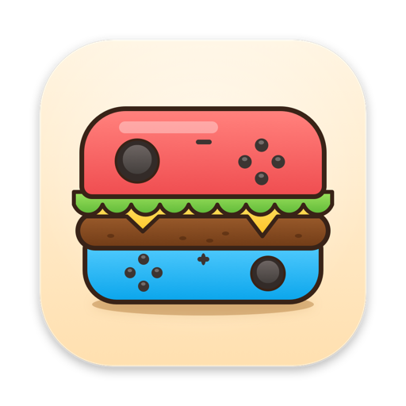

<p align="center">
  
</p>

<h1 align="center">Borgir</h1>

<p align="center">A Nintendo Switch emulator for Apple silicon Macs, with a native Metal renderer and a native macOS interface.</p>

- **Metal only.** Games always render with the native Metal backend; there is no Vulkan, OpenGL or MoltenVK.
- **A native macOS interface.** SwiftUI windows for the game library, settings, keys and firmware, built from
  [`macos/ProjectXUI`](macos/ProjectXUI).
- **Game details.** Clicking a game opens a pane with a Play button, its settings, update (pick one or add files), DLC,
  mods (toggle, import a mod folder or a ZIP, 7z or RAR download, move one to the Trash) and cheats (toggle, even while
  it runs; add cheat files).
- **Per-game settings.** A game can have its own resolution, docked mode, V-Sync, hypervisor, DRAM size and more;
  everything else follows the global settings. Changes made in a game's overlay become that game's own settings.
- **Background shader compiling (optional).** Settings › Graphics can compile new shaders without waiting for them,
  for shorter freezes when a game first uses one; objects that use a new shader appear a few frames late. Off by
  default, and can be set per game.
- **Controllers.** Settings › Input sets up players 1 to 8 and Handheld: device, controller type, button remapping
  (press the key or button), stick dead zones, rumble and motion. When a game asks for controllers, a prompt shows who
  has what and opens these settings.
- **Profiles.** Settings › Profiles adds, renames and deletes user profiles and sets their pictures, from an image file
  or from the Switch avatars in the installed firmware. The toolbar's profile button shows the active profile's picture.
- **An in-game overlay.** Liquid Glass controls over the running game: pause, stop, docked mode, V-Sync, volume,
  resolution, aspect ratio, filtering, screenshot, full screen. It appears when the pointer moves.
- **Screenshots on Metal.** Saved to the data folder's `screenshots` folder.

Borgir needs macOS 26 or later on Apple silicon.

## Install

Download `Borgir-<version>.dmg` from [Releases](https://github.com/vasist15-source/borgir/releases), open it and drag
Borgir to Applications. Borgir is signed ad hoc, not with an Apple Developer ID, so macOS stops the first launch: choose
Done, then open System Settings › Privacy & Security and click Open Anyway next to the message about Borgir. If macOS
says Borgir is damaged instead, clear the download's quarantine flag and open it again:

```bash
xattr -dr com.apple.quarantine /Applications/Borgir.app
```

Games need keys and firmware dumped from your own Switch: install them from Settings › General. Borgir includes no
keys, firmware or games.

## Build

Needs the .NET SDK from [global.json](global.json) (10.0.301 or later) and the Xcode Command Line Tools
(`xcode-select --install`). Full Xcode is not required.

```bash
distribution/macos/build_borgir.sh
```

The script publishes the emulator, builds the SwiftUI library, assembles `artifacts/Borgir.app` and signs it ad hoc
with the hypervisor and JIT entitlements. `NO_RESTORE=1` builds from the local package cache when the package servers
can't be reached. To install it, quit Borgir and replace the copy in Applications (replace, don't merge: leftover files
would break the app's signature):

```bash
rm -rf "/Applications/Borgir.app" && ditto "artifacts/Borgir.app" "/Applications/Borgir.app"
```

## Data

Borgir reads the standard Ryujinx data folder, `~/Library/Application Support/Ryujinx`, so it shares keys, firmware,
saves, profiles, mods and shader caches with Ryujinx. Its settings live in `Borgir.json` in that folder; on first launch
they are copied from the folder's `Config.json`, which Borgir never writes to. A game's own settings are in
`games/<title id>/borgir-settings.json`.

## Notes

- `Ryujinx.LibHac` pre-releases come from Ryubing's package server. A verified copy is vendored in
  [nuget-local](nuget-local/README.md), so builds work when that server is down.
- The bridge between the emulator and the interface is described in [src/Ryujinx/Native/README.md](src/Ryujinx/Native/README.md).
- The icon, a burger whose buns are two controller halves, is drawn by
  [`distribution/macos/make_icon.swift`](distribution/macos/make_icon.swift).

## Credits and license

Borgir is built on [Ryujinx](https://git.ryujinx.app/ryubing/ryujinx) (Ryubing) and on the Metal backend of
[Ryujinx_Optime](https://github.com/sunsssyc/Ryujinx_Optime). It is released under the MIT license, like Ryujinx; see
[LICENSE.txt](LICENSE.txt) and [THIRDPARTY.md](distribution/legal/THIRDPARTY.md).
